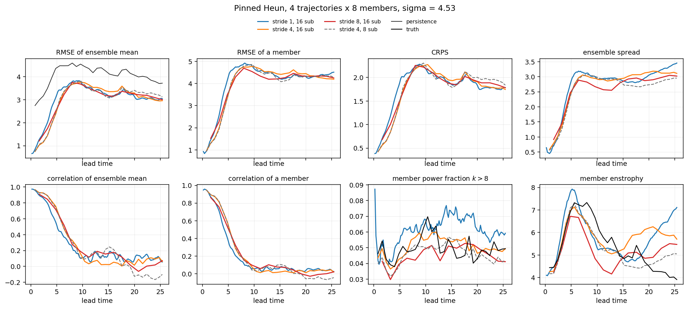
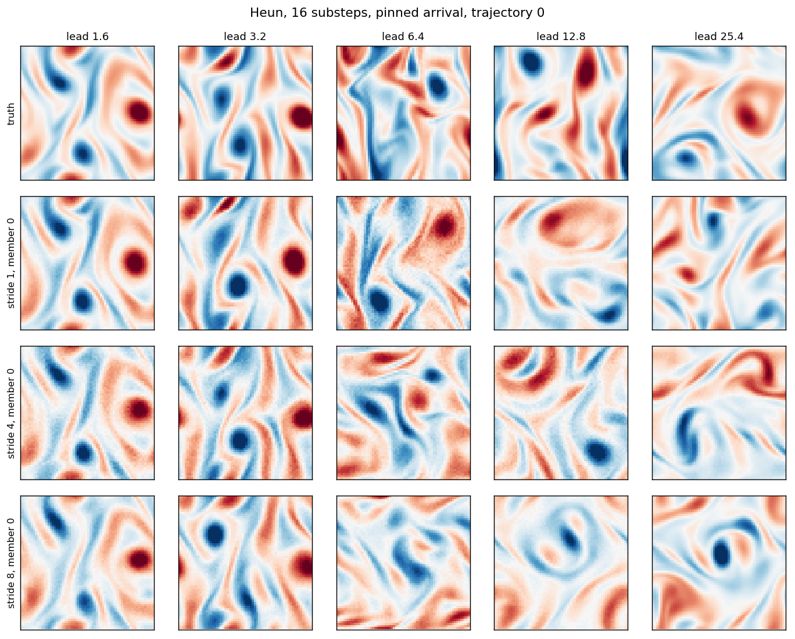
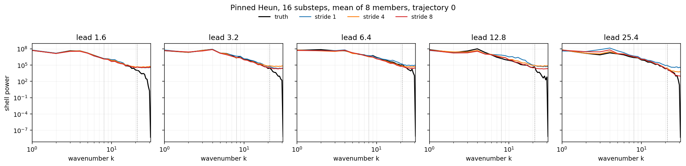

# ABC for Kolmogorov flow

A bridge in physical time ([ABC](https://arxiv.org/abs/2604.27443), Guo et al., 2026, [code](https://github.com/gabeguo/abc_diffusion)), trained on forced 2D Kolmogorov flow. One model covers different Δt and non-causal inference. This was done out of curiosity, to carry the examples in the paper over to something more physical.

The flow is 64², `nu = 0.01`, `kf = 4`, with frames 0.2 apart. Training mixes bridges of 1, 2, 4, and 8 frames.

That rollout stays at the truth's enstrophy out to lead >1000. With the kick left in, a short stride stores every noisy frame and enstrophy runs away. At lead 1.6, stride 4 and 16 substeps give ensemble-mean correlation 0.93, RMSE 1.03, CRPS 0.56. By lead 25 the correlation is about zero: the members stay in the right amplitude, but the vortices are no longer the true ones. 

Python 3.12, CUDA, `torch==2.7.1`, `numpy==2.3.5` (`pip install -r requirements.txt`; pick the CUDA wheel from [pytorch.org](https://pytorch.org)). Weights: `weights/kolmogorov_step20000.pt` (20k steps, `base = 64`, `sigma = 4.53`). The cache is not in git.

```bash
python -m abc_kolmogorov.gen_data
python -m abc_kolmogorov.sample --ckpt weights/kolmogorov_step20000.pt --cache cache/kolmogorov_64.npz --out outputs/forecast
```

Default is Heun, stride 4, 16 substeps. Numbers for strides 1, 4, and 8 are in `examples/metrics.json`.







Video of the same trajectory: [examples/forecast.mp4](examples/forecast.mp4).
